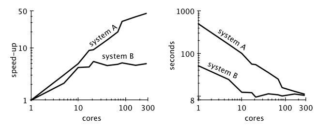
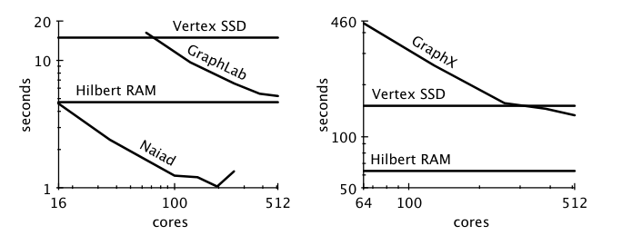
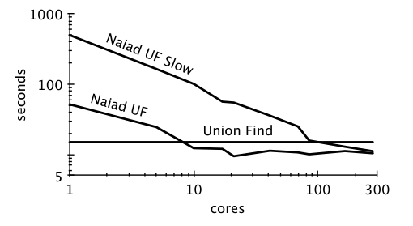

# 可扩展性！但要付出怎样的 COST？

*Scalability! But at what COST?*

**作者：** Frank McSherry、Michael Isard、Derek G. Murray  
**作者署名机构：** 无所属机构（Unaffiliated）  
**发表：** HotOS XV，2015 年  
**原文：** [USENIX PDF](https://www.usenix.org/system/files/conference/hotos15/hotos15-paper-mcsherry.pdf)

> **译者说明：** 本文根据用户提供的本地 PDF 翻译，保留摘要、正文全部章节、5 张表、6 幅图的编号与图注、代码、作者脚注和 25 条参考文献。图 1、5、6 使用原图；图 2、3、4 为原文代码，以代码块呈现。参考文献保留英文书目信息，方便检索。正文中的“我们”指原作者，时间表述及性能数字均对应原文发表时的背景。本译文不是作者审定版本。
>
> **术语：** scalability 译为“可扩展性”，speed-up 译为“加速比”，overhead 译为“额外开销”，single thread 译为“单线程”。COST 是 **Configuration that Outperforms a Single Thread** 的缩写，意为“性能超过单线程所需的配置”；标题也借用了英文 cost（代价）的含义。

## 摘要

我们为大数据平台提出一个新的指标：COST，即“性能超过单线程所需的配置”（Configuration that Outperforms a Single Thread）。对于给定的问题，一个平台的 COST，就是该平台要超过一个实现得当的单线程程序所需的硬件配置。COST 将系统的可扩展性与系统引入的额外开销一并考量，反映系统带来的实际性能收益，而不会让引入大量可并行化开销的系统因此获得好评。

我们考察了近期 SOSP 和 OSDI 论文中报告的数据并行系统测量结果，发现许多系统的 COST 高得惊人，往往需要数百个核心；另一些系统在所有报告过的配置下，性能都不如一个线程。

## 1 引言

> “先证明你知道如何用好第一台计算机，再给你第二台。”
>
> —— Paul Barham

已发表的大数据系统研究过分推崇可扩展性，把它视为分布式数据处理平台最重要的特性。几乎所有此类论文都会详细介绍系统令人印象深刻的可扩展性，却很少直接拿合理的基准来评价其绝对性能。这些系统究竟在多大程度上真正改善了性能，又在多大程度上只是在并行处理自己引入的额外开销？

人们通常认为，良好的扩展表现说明系统构建扎实。然而，只要实现足够不讲究，任何系统都能表现出任意好的扩展性。图 1 的两条扩展曲线，展示了一项 Naiad 计算在性能优化前（系统 A）和优化后（系统 B）的情况。该优化消除了可以并行化的额外开销，虽然使所有配置下的性能都得到改善，却损害了表面上的可扩展性。



**图 1：** 一个数据并行算法在进行简单性能优化之前（系统 A）和之后（系统 B）的扩展性与性能测量。未经优化的实现表现出好得多的“扩展性”，尽管它的性能很差——或者更准确地说，正是因为它的性能很差。

> **图中文字对照（译者补充）：** cores：核心数；speed-up：加速比；seconds：秒；system A/B：系统 A/B。

这个例子可能看起来是人为构造的，但我们将论证，许多已经发表的大数据系统更接近系统 A，而非系统 B。

### 1.1 方法

本文选取系统领域近期发表的若干图处理论文，使用相同的数据集，将其报告的性能与在一台 2014 年高端笔记本电脑上运行的简单单线程实现进行比较。或许令人意外的是，对于这些系统所应用的各项问题，许多已发表系统的 COST 都是无界的，也就是说，没有配置能够超过最好的单线程实现。

这些比较既不完美，也并非总是公平，但结果差异足够显著，值得引起关注。有些单线程实现，比使用数百个核心的系统所报告的结果还快一个数量级以上。我们识别了这些差距背后的原因：有些是领域本身固有的，有些完全可以避免，还有一些值得进一步研究。

我们强调，问题未必出在系统本身——系统可能随时间而改进——而更在于作者提供了怎样的测量，以及审稿人和读者要求怎样的标准。我们希望揭示这一问题，引导未来的研究走向这样的分布式系统：其可扩展性源于系统设计上的进步，而不是薄弱的基线和过低的期望。

> **作者脚注：** Michael Isard 参与本项工作时任职于微软研究院，发表时已无所属机构。Derek G. Murray 参与本项工作时无所属机构，发表时已就职于 Google Inc.
>
> **译者说明：** 原文对“无界 COST”的判断来自所考察论文报告的配置和测量数据；摘要也明确限定为所有“报告过的配置”。这里保留原文术语，不将它扩展为对一切未测试配置的证明。

## 2 基本图计算

图计算在近期的 SOSP 和 OSDI 会议中占据重要位置。它代表了一类相对简单、但并非轻易就能并行化的数据并行计算。恰好 Gonzalez 等人 [10] 在 2014 年评估了若干图处理系统的最新版本。我们使用单线程 C# 代码实现了其中的每项任务，并在他们使用的相同数据集上评估这些实现，见表 1。[^implementation]

**表 1：“twitter rv”和“uk-2007-05”图。**

| 名称 | twitter rv [13] | uk-2007-05 [5, 6] |
|---|---:|---:|
| 节点数 | 41,652,230 | 105,896,555 |
| 边数 | 1,468,365,182 | 3,738,733,648 |
| 大小 | 5.76 GB | 14.72 GB |

我们的单线程实现采用一种简单的、类似 Boost 的图遍历方式。`GraphIterator` 类型接收作用于边的操作，并将该操作应用到图的所有边上。实现使用无缓冲 I/O 从 SSD 读取二进制边数据，并将每个节点的状态保存在使用大页（2 MB）的内存中。

[^implementation]: 我们的 C# 实现需要手动进行一些内联处理，不如 Rust 实现简洁。为使表达清楚，本文展示后者。两个版本的结果相近，代码将在线公开。

### 2.1 PageRank

PageRank 是一种在有向图上进行的计算，它通过迭代更新每个顶点保存的排名值 [19]。每轮迭代中，顶点的排名值均分给其出边所指向的邻居；随后，顶点的新排名值设为来自入边邻居的、经过缩放的排名贡献之和。对排名值施加阻尼系数 `alpha`，减少的排名总量均匀分配给所有节点。图 2 给出了执行 20 轮 PageRank 迭代的代码。

```rust
fn PageRank20(graph: GraphIterator, alpha: f32) {
    let mut a = vec![0f32; graph.nodes()];
    let mut b = vec![0f32; graph.nodes()];
    let mut d = vec![0f32; graph.nodes()];

    graph.map_edges(|x, y| { d[x] += 1; });

    for iter in 0..20 {
        for i in 0..graph.nodes() {
            b[i] = alpha * a[i] / d[i];
            a[i] = 1f32 - alpha;
        }

        graph.map_edges(|x, y| { a[y] += b[x]; });
    }
}
```

**图 2：20 轮 PageRank 迭代。**

表 2 将若干系统报告的运行时间，与分别从 SSD 或 RAM 读取数据的单线程 PageRank 实现进行比较。除了 GraphChi 和 X-Stream 会从磁盘重新读取边数据之外，其余系统都将图数据分区到多台机器上并加载到内存中。除了 GraphLab 和 GraphX 之外，其他系统都按源顶点划分边；GraphLab 和 GraphX 使用了更复杂的分区策略来减少通信。

**表 2：已报告的 20 轮 PageRank 迭代耗时，与从 SSD 和 RAM 读取数据的单线程实现实测耗时的比较。GraphChi 和 X-Stream 报告的是 5 轮 PageRank 迭代耗时，我们将其乘以 4。**

| 可扩展系统 | 核心数 | twitter | uk-2007-05 |
|---|---:|---:|---:|
| GraphChi [12] | 2 | 3160 s | 6972 s |
| Stratosphere [8] | 16 | 2250 s | — |
| X-Stream [21] | 16 | 1488 s | — |
| Spark [10] | 128 | 857 s | 1759 s |
| Giraph [10] | 128 | 596 s | 1235 s |
| GraphLab [10] | 128 | 249 s | 833 s |
| GraphX [10] | 128 | 419 s | 462 s |
| 单线程（SSD） | 1 | 300 s | 651 s |
| 单线程（RAM） | 1 | 275 s | — |

表 2 中没有哪个可扩展系统能始终超过单线程，即使这个单线程需要反复从外部存储读取数据。只有 GraphLab 和 GraphX 在某些比较中超过了单线程运行结果。不过，第 3.1 节将表明，一旦以类似这些系统分区策略的方式重新排列边，单线程实现也会超过它们。

### 2.2 连通分量

无向图的连通分量，是彼此不相交的顶点集合；同一个集合中的所有顶点都能相互到达。

在分布式环境中，计算连通性最常见的算法是标签传播 [11]，见图 3。标签传播中，每个顶点维护一个标签，初始值是自己的 ID；随后反复更新标签，使其等于自己当前标签和所有邻居标签中的最小值。这一过程把每个连通分量中的最小标签传播给该分量内的所有顶点。当每个分量都完成传播时，迭代便收敛。更新操作满足交换律和结合律，因此可以采用可扩展的实现方式 [7]。

```rust
fn LabelPropagation(graph: GraphIterator) {
    let mut label = (0..graph.nodes()).to_vec();
    let mut done = false;

    while !done {
        done = true;
        graph.map_edges(|x, y| {
            if label[x] != label[y] {
                done = false;
                label[x] = min(label[x], label[y]);
                label[y] = min(label[x], label[y]);
            }
        });
    }
}
```

**图 3：标签传播。**

表 3 将若干数据并行系统报告的标签传播运行时间，与一个从 SSD 读取数据的单线程实现进行比较。尽管所使用的硬件资源少了若干个数量级，单线程标签传播仍明显快于表中任何一个系统。

**表 3：已报告的标签传播耗时，与从 SSD 读取数据的单线程标签传播实测耗时的比较。**

| 可扩展系统 | 核心数 | twitter | uk-2007-05 |
|---|---:|---:|---:|
| Stratosphere [8] | 16 | 950 s | — |
| X-Stream [21] | 16 | 1159 s | — |
| Spark [10] | 128 | 1784 s | ≥ 8000 s |
| Giraph [10] | 128 | 200 s | ≥ 8000 s |
| GraphLab [10] | 128 | 242 s | 714 s |
| GraphX [10] | 128 | 251 s | 800 s |
| 单线程（SSD） | 1 | 153 s | 417 s |

## 3 更好的基线

前面展示的单线程实现，是我们能够想到的最简单、最直接的实现。还可以使用若干常规方法来改进它们。改进后的单线程实现，会全面超过我们所考察系统报告的性能；某些情况下，还能在原有优势上再快一个数量级。

### 3.1 改进图的布局

我们的单线程算法以边迭代器作为输入。虽然它们不要求以特定顺序提供边，但边的顺序确实会影响性能。到目前为止，单线程实现都是按顶点顺序枚举边，即先提供一个顶点的所有边，再处理下一个顶点。而 GraphLab 和 GraphX 会把边划分给不同的工作单元，并不要求来自同一顶点的所有边都属于同一个工作单元。这使这些系统能够减少数据交换 [9, 10]。

单线程图算法没有显式通信，但边的排列顺序会显著影响缓存行为。例如，Hilbert 曲线 [2] 所定义的边顺序，类似于根据顶点编号 `a` 和 `b` 的比特交错结果来排列边 `(a, b)`，它能同时在 `a` 和 `b` 两个方向上体现局部性，而按顶点排序只体现 `a` 的局部性。表 4 将按 Hilbert 曲线顺序提供边的单线程 PageRank，与其他实现的运行时间进行比较。可以看到，它超过了所有被比较的实现。

**表 4：已报告的 20 轮 PageRank 迭代耗时，与从 SSD 和 RAM 读取数据的单线程实现实测耗时的比较。各单线程实现使用相同算法，但边的顺序不同。**

| 可扩展系统／实现 | 核心数 | twitter | uk-2007-05 |
|---|---:|---:|---:|
| GraphLab | 128 | 249 s | 833 s |
| GraphX | 128 | 419 s | 462 s |
| 顶点顺序（SSD） | 1 | 300 s | 651 s |
| 顶点顺序（RAM） | 1 | 275 s | — |
| Hilbert 顺序（SSD） | 1 | 242 s | 256 s |
| Hilbert 顺序（RAM） | 1 | 110 s | — |

将图数据转换为 Hilbert 曲线顺序，会增加图预处理的成本。这个过程相当于把节点编号对（即边）转换成位数加倍的整数，对这些整数排序，然后再转换回节点编号对。我们的实现用一个线程，在 179 秒内完成了 `twitter rv` 图的转换。即使把预处理时间计入运行时间，这种做法仍可能获得性能收益。

### 3.2 改进算法

恰当地选择一个好算法，是计算机科学的核心问题。标签传播被用来计算图的连通性，并不是因为它是一个好算法，而是因为它符合“像顶点一样思考”（think like a vertex）的计算模型 [15]，而这个模型的实现具有良好的扩展性。不幸的是，在这个例子以及许多其他例子中，诱人的扩展表现很大程度上来自算法本身并不够优：标签传播只是比更好的算法做了更多工作。

考虑另一种算法：带加权合并的并查集（Union-Find）[3]。这是一个简单的 $O(m\log n)$ 算法，只需扫描一遍图的边，并为每个顶点维护两个整数，如图 4 所示。表 5 将它与标签传播实现进行比较；它比其中最快的实现——单线程标签传播——还快一个数量级以上。

```rust
fn UnionFind(graph: GraphIterator) {
    let mut root = (0..graph.nodes()).to_vec();
    let mut rank = [0u8; graph.nodes()];

    graph.map_edges(|mut x, mut y| {
        while (x != root[x]) { x = root[x]; }
        while (y != root[y]) { y = root[y]; }
        if x != y {
            match rank[x].cmp(&rank[y]) {
                Less    => { root[x] = y; },
                Greater => { root[y] = x; },
                Equal   => { root[y] = x; rank[x] += 1; },
            }
        }
    });
}
```

**图 4：带加权合并的并查集。**

**表 5：不同连通性算法的耗时。**

| 可扩展系统／实现 | 核心数 | twitter | uk-2007-05 |
|---|---:|---:|---:|
| GraphLab | 128 | 242 s | 714 s |
| GraphX | 128 | 251 s | 800 s |
| 单线程（SSD） | 1 | 153 s | 417 s |
| 并查集（SSD） | 1 | 15 s | 30 s |

计算图连通性还有许多其他高效算法，其中一些虽然不符合“像顶点一样思考”的模型，却可以并行化。即便某些算法并不是某个分布式系统最适合采用的方案，它们仍然是必须考虑的合理替代方案。

## 4 将 COST 应用于已有工作

有了单线程实现，我们就有了评估系统 COST 的基础。作为一次尝试，我们将这些基线回溯应用于现有可扩展系统已经发表的测量数字。

### 4.1 PageRank

图 5 展示了 PowerGraph [9]、GraphX [10] 和 Naiad [16] 已发表的扩展性数据，同时用两条水平线表示两种单线程测量结果。

与上方水平线的交点，表示系统开始超过一个简单、资源受限的实现。这适合作为具有类似限制的系统的基线，例如 GraphChi 和 X-Stream。与下方水平线的交点，表示系统开始超过一个具备更充分条件的实现，包括预处理和足够内存。这适合作为具有类似资源的系统的基线，例如 GraphLab、Naiad 和 GraphX。



**图 5：在 twitter rv 上运行 PageRank 的已发表扩展性测量。左图为预热后每轮迭代的时间；右图为从冷启动开始执行 10 轮迭代的时间。水平线为单线程测量结果。**

> **图中文字对照（译者补充）：** Vertex SSD：顶点顺序、从 SSD 读取；Hilbert RAM：Hilbert 顺序、从内存读取；cores：核心数；seconds：秒。左右图采用不同计时口径，应分别与各自图中的单线程水平线比较。

从这些曲线可以说，Naiad 在 `twitter rv` 图上运行 PageRank 的 COST 为 16 个核心。GraphLab 虽然没有把某项结果绘入其扩展性曲线，但报告了在 512 个核心上耗时 3.6 秒的测量，因此其 COST 为 512 个核心。GraphX 没有与相应的单线程测量线相交，我们因此称它的 COST 为无界。

### 4.2 图连通性

已发表的工作没有提供图连通性计算的扩展性数据。不过，考虑到这些可扩展系统中的标签传播相对于单线程并查集的绝对性能，我们并不乐观地认为，补上这些扩展性数据就能得到一个有界的 COST。

作为替代，图 6 展示了两个基于 Naiad 的并行并查集实现 [14] 的扩展情况，它们就是图 1 中的两个例子。这两个实现的区别在于如何存储每个顶点的状态：较慢的实现使用哈希表，较快的实现使用数组。较快实现的 COST 为 10 个核心，而较慢实现的 COST 大约为 100 个核心。



**图 6：两个基于 Naiad 的并查集实现。**

> **图中文字对照（译者补充）：** Naiad UF Slow：较慢的 Naiad 并查集实现；Naiad UF：较快的 Naiad 并查集实现；Union Find：单线程并查集基线；cores：核心数；seconds：秒。

使用哈希表是 COST 增加约 10 倍的根本原因，但它也提供了一定价值：节点标识符不必位于一个紧凑的整数集合中。这种评价方法，使系统实现者和潜在用户都能更清楚地看到这项权衡。

## 5 得到的启示

可扩展系统设计与实现中的若干因素，会引入额外开销并增大 COST。系统提供的计算模型，限制了能够表达的程序。目标硬件也可能体现不同的权衡，例如比起高时钟频率，更看重容量和吞吐量。最后，系统实现还可能引入单线程并不需要的开销。理解这些开销的各个来源，是评估可扩展系统能力及贡献的重要部分。

为了实现可扩展的并行处理，大数据系统把程序限制在并行性明显的模型之内。这些模型可能不符合程序员的意图，也可能无法匹配当前问题最高效的并行实现。Map-Reduce 为了可扩展性，有意排除了常驻内存的状态，因而给那些能从这种状态中获益的算法带来了大量开销。Pregel 的“像顶点一样思考”模型，要求把图计算表达为每个顶点依据邻居状态反复进行的局部计算；这只能涵盖高效图算法中的一个有限子集。这两种设计都不是“错误的选择”，但区分“可扩展性”和“高效利用资源”很重要。

集群计算环境与笔记本电脑环境不同。前者往往比起延迟，更重视高容量和高吞吐量，其核心、存储和内存可能更慢。如今，笔记本电脑代表了个人计算机：容量较小，但核心、存储和内存更快。尽管可扩展系统往往适合集群资源，要追求最高性能，仍然需要考虑其他硬件选择。

最后，系统实现可能引入额外开销，掩盖可扩展系统在性能上的收益。高级语言可以简化开发，但也可能引入性能问题，例如垃圾回收、边界检查和内存复制。在研究工作中，尤其常见的一种做法是：用系统其他部分——序列化、内存管理、网络通信——不完整或简陋的实现来评估一个新想法，并声称可以利用已有技术改善其性能。这些问题中的许多，确实可能通过并不进一步推动研究创新的工程工作来改善。然而，去掉这些冗余之后，系统所声称的收益是否仍然存在，可能很难判断。

与最快的、为特定任务专门构建的单线程实现相比，一个系统具有较高 COST，可能有许多充分理由。它可能针对另一组问题，适合另一种部署环境，或者只是用于评估完整系统中某些组件的原型。系统还可能提供简单方案不具备的其他方面的优势，例如与现有生态集成、高可用性或安全性。

正如第 4 节所展示的，即便如此，评估 COST 仍然重要：一方面，它有助于解释较高的 COST 是否为所提出系统固有的；另一方面，它能揭示可以避免的低效之处，从而促成系统性能的改善。

## 6 未来方向（针对本领域）

虽然这篇短文看起来是在批评分布式系统研究，但我们相信仍有很多值得做的工作。我们的目标，是提供一个衡量进展、并尽可能推动良好进展的框架。

可扩展的算法与计算模型有许多先例，只需回顾几十年前的并行计算研究即可。Borůvka 算法 [1] 已有近 90 年历史，可以自然地并行化，而且能解决比标签传播更一般的问题。整体同步并行模型（Bulk Synchronous Parallel，BSP）[24] 的通用程度，也远超大多数论文相关工作部分给人的印象。这些算法和模型已有丰富的细节描述和分析，其中很多也已经实现。

性能优良的可扩展系统同样有许多实例。Galois [17] 和 Ligra [23] 都是共享内存系统；在单机上运行时，它们显著超过了相应的分布式系统。Naiad [16] 引入了一种新的通用数据流模型，甚至超过了专用系统。理解这些系统做对了什么、以及如何改进它们，比把已有想法换个领域重新包装，并且仅与先前工作中最差的方案比较，更为重要。

我们已经开始看到针对当前这批可扩展系统的性能研究 [18]，它们正在挑战这些系统设计原则背后的某些传统认识。过去几代系统中，也出现过类似研究 [22]，包括明确批评可扩展系统相对于简单方案的绝对性能的工作 [20, 4, 25]。理解并学习流行可扩展系统的性能特征当然有价值，但我们或许也会发现：我们一直在重复犯下、并发表同样的错误。

从根本上说，好的研究有一部分工作，就是确保我们提出了正确的问题。“能否让系统表现出良好的扩展性？”在引言中就能轻易回答，它本身并不是正确的问题。仍然有大量有价值的研究值得开展，但要识别真正的进步，就必须更坦诚地面对已经存在的替代方案。可扩展系统的 COST 使用了其中最简单的一种替代方案，但它是理解和阐明这些系统研究取得了何种进展的重要组成部分。

## 参考文献

> 保留原文编号与英文书目信息。文献题名、作者拼写与个别标点原则上依照原文；原 PDF 中 [18] 的作者姓名后带有问号，此处保留。

[1] [Borůvka’s algorithm](http://en.wikipedia.org/wiki/Boruvka%27s_algorithm).

[2] [Hilbert curve](http://en.wikipedia.org/wiki/Hilbert_curve).

[3] [Union find](http://en.wikipedia.org/wiki/union_find).

[4] Eric Anderson and Joseph Tucek. Efficiency Matters! HotStorage 2009.

[5] Paolo Boldi and Sebastiano Vigna. The WebGraph Framework I: Compression Techniques. WWW 2004.

[6] Paolo Boldi, Bruno Codenotti, Massimo Santini, and Sebastiano Vigna. UbiCrawler: A Scalable Fully Distributed Web Crawler. Software: Practice & Experience 2004.

[7] Austin T. Clements, M. Frans Kaashoek, Nickolai Zeldovich, Robert T. Morris, and Eddie Kohnler. The Scalable Commutativity Rule: Designing Scalable Software for Multicore Processors. SOSP 2013.

[8] Stephan Ewen, Moritz Kaufmann, Kostas Tzoumas, and Volker Markl. Spinning Fast Iterative Data Flows. VLDB 2012.

[9] Joseph E. Gonzalez, Yucheng Low, Haijie Gu, Danny Bickson, Carlos Guestrin. PowerGraph: Distributed Graph-Parallel Computation on Natural Graphs. OSDI 2012.

[10] Joseph E. Gonzalez, Reynold S. Xin, Ankur Dave, Daniel Crankshaw, and Michael J. Franklin, and Ion Stoica. GraphX: Graph Processing in a Distributed Dataflow Framework. OSDI 2014.

[11] U Kang, Charalampos E. Tsourakakis, and Christos Faloutsos. PEGASUS: Mining Peta-Scale Graphs. ICDM 2009.

[12] Aapo Kyrola, Guy Blelloch, and Carlos Guestrin. GraphChi: Large-Scale Graph Computation on Just a PC. OSDI 2012.

[13] Haewoon Kwak, Changhyun Lee, Hosung Park, and Sue Moon. What is Twitter, a social network or a news media? WWW 2010.

[14] Silvio Lattanzi, Benjamin Moseley, Siddharth Suri, and Sergei Vassilvitskii. Filtering: A Method for Solving Graph Problems in MapReduce. SPAA 2011.

[15] Grzegorz Malewicz, Matthew H. Austern, Aart J. C. Bik, James C. Dehnert, Ilan Horn, Naty Leiser, and Grzegorz Czajkowski. Pregel: A System for Large-Scale Graph Processing. SIGMOD 2010.

[16] Derek G. Murray, Frank McSherry, Rebecca Isaacs, Michael Isard, Paul Barham, and Martín Abadi. Naiad: A Timely Dataflow System. SOSP 2013.

[17] Donald Nguyen, Andrew Lenharth, and Keshav Pingali. A Lightweight Infrastructure for Graph Analytics. SOSP 2013.

[18] Kay Ousterhout, Ryan Rasti?, Sylvia Ratnasamy, Scott Shenker, and Byung-Gon Chun. Making Sense of Performance in Data Analytics Frameworks. NSDI 2015.

[19] Lawrence Page, Sergey Brin, Rajeev Motwani, and Terry Winograd. The PageRank citation ranking: Bringing order to the web. Technical report, Stanford Digital Library Technologies Project, 1998.

[20] Alexander Rasmussen, George Porter, Michael Conley, Harsha V. Madhyastha Radhika Niranjan Mysore, Alexander Pucher, and Amin Vahdat. TritonSort: A Balanced Large-Scale Sorting System. NSDI 2011.

[21] Amitabha Roy, Ivo Mihailovic, and Willy Zwaenepoel. X-Stream: Edge-Centric Graph Processing using Streaming Partitions. SOSP 2013.

[22] Mehul A. Shah, Samuel Madden, Michael J. Franklin, and Joseph M. Hellerstein. Java Support for Data-Intensive Systems: Experiences Building the Telegraph Dataflow System. SIGMOD Record 2001.

[23] Julian Shun and Guy Blelloch. Ligra: A Lightweight Graph Processing Framework for Shared Memory. PPoPP 2013.

[24] Leslie G. Valiant. A bridging model for parallel computation. Communications of the ACM, Volume 33 Issue 8, Aug. 1990.

[25] Ce Zhang and Christopher Ré. DimmWitted: A Study of Main-Memory Statistical Analytics. VLDB 2014.

---

## 译者附注：与本项目 notebook 的对应关系

以下说明不属于原论文。

- **第 1 节与图 1：** 对应 notebook 中“删除可并行开销之后，绝对耗时下降，自加速比却可能变小”的模型。
- **第 3.1 节：** 强调数据布局与缓存行为。Notebook 中 CSR 与 bincount 的比较同时涉及表示方式和执行内核。新增第 5.1 节用同一编译内核单独比较 vertex 与 Hilbert 边顺序，并单列预处理成本；这是内存数组教学移植。
- **第 3.2 节：** 对比的是同一任务的不同算法（标签传播与并查集）。新增 `cost_connected_components.ipynb` 比较原地标签传播与并查集，展示边顺序、工作量与图结构如何影响结果。
- **第 4 节：** 对应“需要多少资源才能超过合理单线程基线”的比较。Notebook 的 4 进程共享内存 bincount 虽然相对直接 bincount 获得明显加速，仍需与单线程 CSR 比较。
- **图 2 的代码：** 为忠实于原文，保留其初始化与缩放方式，没有改写为本项目的概率归一化、悬挂节点处理版本。PageRank notebook 第 5.1 节另设保留作者零初始化和 reset 语义的实验。实现来源和验证范围见 `author_sources.md`。
