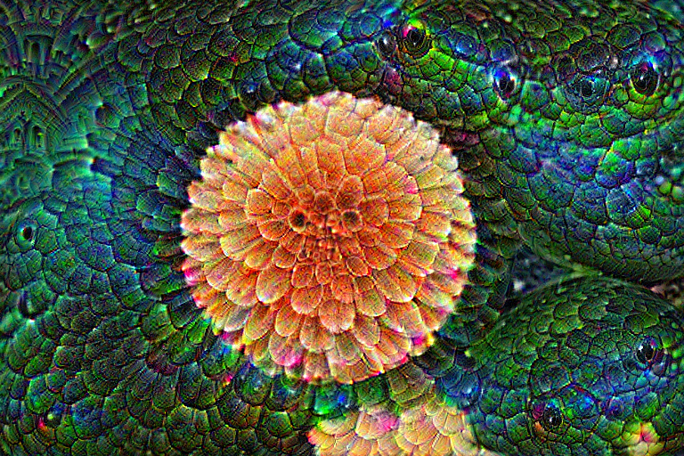

# 花卉 DeepDream

用 ImageNet 预训练的 GoogLeNet，固定网络权重，通过梯度上升修改花卉照片的像素。逐渐出现重复的眼状、鳞片状纹理和彩色边缘。




## 运行

入门可先看 [Iris 小模型实验](iris/README.md)：只用 150 条样本和 51 个参数，逐格复现隐藏特征分析、输入梯度优化与单神经元因果干预，附已执行 Notebook。

另见 [左右朝向的狗头特征复现](dog-direction/README.md)：使用 Olah 论文对应的 InceptionV1 模型及通道编号，对比同一狗头镜像前后的激活和热图。

建议 Python 3.11–3.13。从本目录执行：

```bash
python3 -m venv .venv
source .venv/bin/activate
python -m pip install -r requirements.txt
python deepdream.py --layer inception4d --steps 35
python build_replay.py
```

第一次运行会下载约 50 MiB 的官方预训练权重。优先使用 Apple MPS，否则使用 CPU。双击生成的 `replay.html` 即可离线查看优化过程、切换原图和拖动进度。

按步骤学习可打开已执行的 [deepdream.ipynb](deepdream.ipynb)：

```bash
jupyter lab deepdream.ipynb
```

## 计算过程

1. 将 RGB 像素映射到 GoogLeNet 特征提取器使用的范围。
2. 最大化选定隐藏层激活值的平方均值，对输入图片求梯度。
3. 沿梯度上升方向修改像素，并限制在合法颜色范围内。
4. 在 200、280、392、548、768 像素宽的五个尺度分别运行 35 步，保留前一个尺度产生的细节；每步随机平移输入以减轻固定网格纹理。

完整模型有 6,624,904 个参数；默认截至 `inception4d` 的特征提取器使用 2,470,080 个参数。程序比较优化前后的参数 SHA-256，确认权重未变。`run.json` 保存实际配置、耗时和中间帧索引。激活目标会随分辨率及随机平移变化，不宜跨尺度直接比较。

`inception3a/` 保存较浅层的 125 步结果；`inception4d/` 保存默认 175 步结果。回放使用实际计算的中间帧，并非在浏览器实时推理。`build_replay.py` 只生成回放，不会重新执行模型。

## 来源

讨论笔记见 [Socrates.md](Socrates.md)：包含 DeepDream 原理、狗头朝向复现、机制可解释性的研究进展，以及它如何帮助定位模型故障、控制行为、改进评估和指导模型设计。

- 方法：[Google Inceptionism（2015）](https://research.google/blog/inceptionism-going-deeper-into-neural-networks/)
- 模型：torchvision `GoogLeNet_Weights.IMAGENET1K_V1`
- 照片：scikit-learn 内置 `flower.jpg`，[Flickr 原始来源](https://www.flickr.com/photos/vultilion/6056698931/)，[CC BY 2.0](https://creativecommons.org/licenses/by/2.0/)。结果图片经过 DeepDream 修改。
