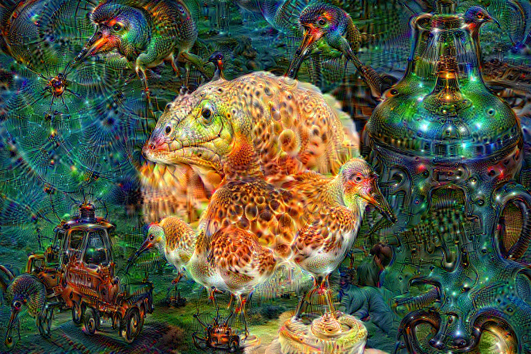
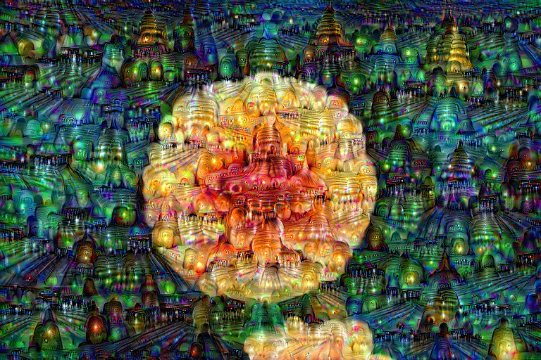
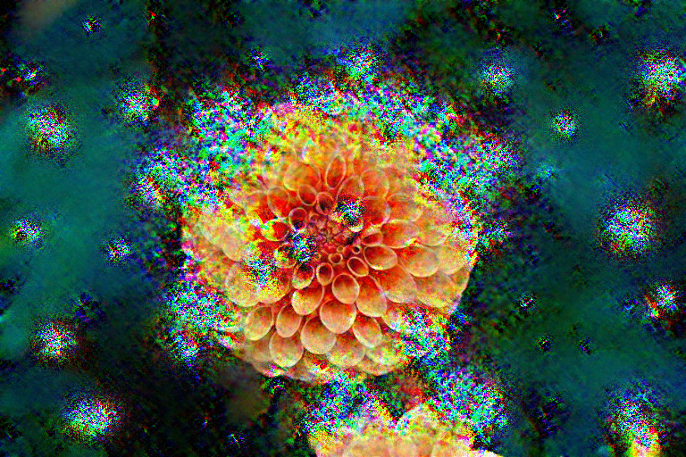
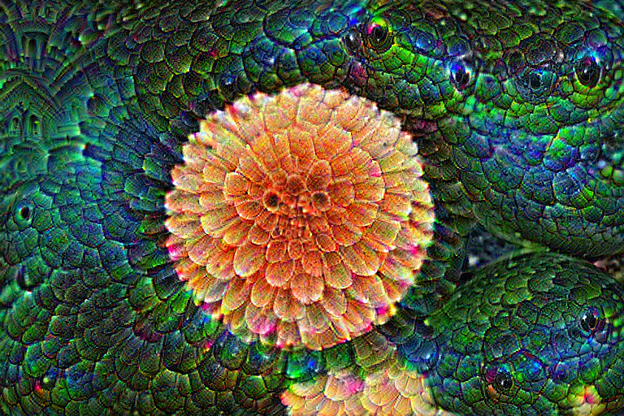

# DeepDream：从迷幻图像到特征解释

用 ImageNet 预训练的 GoogLeNet，固定网络权重，通过梯度上升修改花卉照片的像素。逐渐出现重复的眼状、鳞片状纹理和彩色边缘。

## 从哪里开始

| 想回答的问题 | 实验与阅读入口 |
|---|---|
| 为什么花卉照片会长出眼睛、鳞片？ | [花卉 DeepDream Notebook](deepdream.ipynb) 与 [过程回放](replay.html) |
| 是网络结构还是训练数据造成动物形状？ | [ImageNet / Places205 对照 Notebook](attribution-controls/comparison.ipynb) · [结论与方法](attribution-controls/README.md) |
| 网络真的区分狗头朝左、朝右吗？ | [指定通道的可视化与镜像实验](dog-direction/README.md) |
| 能否用小网络把梯度和干预算清楚？ | [51 参数 Iris 实验](iris/README.md) |

## DeepDream：是结构，还是训练数据？

**本地对照显示：训练形成的权重决定了明显的内容差异；相同结构和优化方式都可以产生密集重复的纹理。** ImageNet 权重长出鸟头、眼睛和动物皮肤般斑纹，Places205 场景权重则长出塔尖、拱门和建筑般结构。

### 同一结构，换训练数据对应的权重

两组使用完全相同的原版 GoogLeNet 特征提取器，固定同一张花卉照片、`inception_4d` 层、输入预处理、随机平移序列和 175 步优化。分类头不参与计算；程序检查结构相同、优化前后权重不变。

**ImageNet：鸟头、眼睛与动物般斑纹。**



**Places205：塔尖、拱门与建筑般层叠结构。**



这组结果支持“动物形态与训练学到的视觉特征有关”。两组都重复、拼接局部形状，但重复的具体内容改变了。Places205 换回训练时的原生输入均值后，建筑般形态仍然出现。

### 随机权重为什么也会出现亮斑？

随机网络仍对像素有响应。我们把像素转换为 `z = 2x − 1`，再最大化内部激活的平方均值。当前随机初始化的网络满足正齐次性：输入相对中灰的幅度放大 t 倍，目标值放大 t² 倍。因此，即使没有学过动物，优化也能通过增强亮暗变化提高目标。



纯灰输入的实测结果如下（随机种子 42）：

| 输入像素值 | 平均归一化梯度 | 更新方向 |
|---|---:|---|
| 暗灰 0.1 | −0.1577 | 更暗 |
| 中灰 0.5 | 0 | 保持不动 |
| 亮灰 0.9 | +0.1096 | 更亮 |

两组随机种子的非零探针都通过了 `(x−0.5)·∇J = 2J` 的数值检查。花形仍可辨认，是因为优化从原图出发，每个尺度继续叠加原图基底；局部亮暗噪斑则来自随机网络响应被反复放大。本次随机结果中，接近白色上限的颜色通道占比从 0.13% 增至 2.18%，同时有 10.10% 接近黑色下限。

### 原作者的解释与本地验证

[Google《Inceptionism》（2015）](https://research.google/blog/inceptionism-going-deeper-into-neural-networks/)已经把动物形状联系到训练数据，并展示了 Places 场景网络的梦境。[《Feature Visualization》（2017）](https://distill.pub/2017/feature-visualization/)进一步讨论了步幅卷积、池化与高频梯度伪影。本地实验固定输入和优化设置重现内容差异，并补充随机权重的灰度探针分析。

这组公开权重各自的训练过程也有差异，因此结果针对训练形成的权重差异。随机权重亮斑分析沿用原实验的 torchvision 结构，数据集对照则使用两套匹配的原版 Caffe GoogLeNet 权重。详细配置见 [对照实验说明](attribution-controls/README.md)，图片与数值检查见 [已执行 Notebook](attribution-controls/comparison.ipynb)。

## 最初的花卉实验




## 运行

入门可先看 [Iris 小模型实验](iris/README.md)：只用 150 条样本和 51 个参数，逐格复现隐藏特征分析、输入梯度优化与单神经元因果干预，附已执行 Notebook。

另见 [左右朝向的狗头特征复现](dog-direction/README.md)：使用 Olah 论文对应的 InceptionV1 模型及通道编号，对比同一狗头镜像前后的激活和热图。

建议 Python 3.11–3.13。从本目录执行：

```bash
python3 -m venv .venv
source .venv/bin/activate
python -m pip install -r requirements.txt
python deepdream.py --layer inception4d --steps 35
python build_replay.py
```

第一次运行会下载约 50 MiB 的官方预训练权重。优先使用 Apple MPS，否则使用 CPU。双击生成的 `replay.html` 即可离线查看优化过程、切换原图和拖动进度。

按步骤学习可打开已执行的 [deepdream.ipynb](deepdream.ipynb)：

```bash
jupyter lab deepdream.ipynb
```

## 计算过程

1. 将 RGB 像素映射到 GoogLeNet 特征提取器使用的范围。
2. 最大化选定隐藏层激活值的平方均值，对输入图片求梯度。
3. 沿梯度上升方向修改像素，并限制在合法颜色范围内。
4. 在 200、280、392、548、768 像素宽的五个尺度分别运行 35 步，保留前一个尺度产生的细节；每步随机平移输入以减轻固定网格纹理。

完整模型有 6,624,904 个参数；默认截至 `inception4d` 的特征提取器使用 2,470,080 个参数。程序比较优化前后的参数 SHA-256，确认权重未变。`run.json` 保存实际配置、耗时和中间帧索引。激活目标会随分辨率及随机平移变化，不宜跨尺度直接比较。

`inception3a/` 保存较浅层的 125 步结果；`inception4d/` 保存默认 175 步结果。回放使用实际计算的中间帧，并非在浏览器实时推理。`build_replay.py` 只生成回放，不会重新执行模型。

## 来源

讨论笔记见 [Socrates.md](Socrates.md)：包含 DeepDream 原理、狗头朝向复现、机制可解释性的研究进展，以及它如何帮助定位模型故障、控制行为、改进评估和指导模型设计。

- 方法：[Google Inceptionism（2015）](https://research.google/blog/inceptionism-going-deeper-into-neural-networks/)
- 模型：torchvision `GoogLeNet_Weights.IMAGENET1K_V1`
- 照片：scikit-learn 内置 `flower.jpg`，[Flickr 原始来源](https://www.flickr.com/photos/vultilion/6056698931/)，[CC BY 2.0](https://creativecommons.org/licenses/by/2.0/)。结果图片经过 DeepDream 修改。
