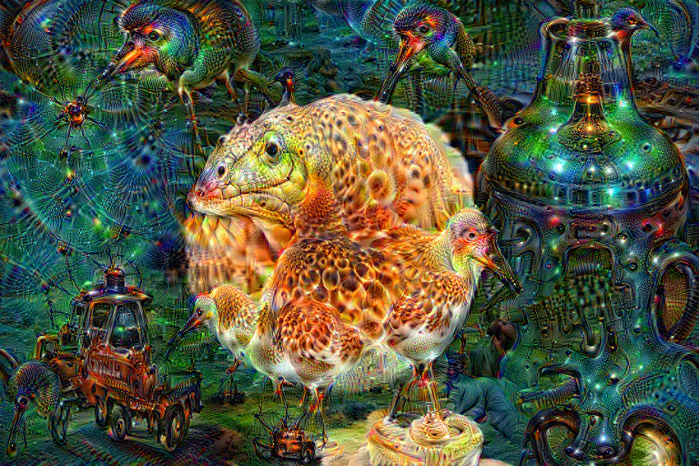
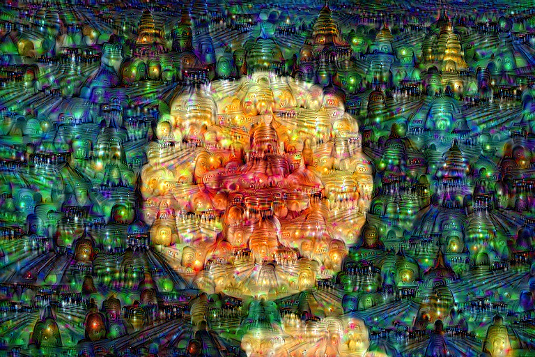

# DeepDream：是结构，还是训练数据？

先打开已执行的 [comparison.ipynb](comparison.ipynb)：包含两组预训练权重、两组随机权重、反色和中灰对照，以及逐项数值检查。

同一张花卉照片、同一 GoogLeNet 特征提取结构，分别加载 ImageNet 和 Places205 的预训练权重，最大化 inception_4d 的激活平方均值。





ImageNet 结果可见鸟头、眼睛与动物皮肤般的斑纹；Places205 结果主要呈现塔尖、拱门和建筑般的重复结构。这些是人工视觉观察。两者都产生密集重复纹理，但具体内容随训练权重显著变化。

## 对照设置

- 两组都使用原版 Caffe GoogLeNet 的同一个 PyTorch 实现；代码断言所用特征提取器的结构完全相同。分类头不参与计算。
- 原来的 torchvision GoogLeNet 含 BatchNorm 等实现差异，因此这里同时重跑 ImageNet 组，不把旧图直接充当匹配对照。
- 相同图片、inception_4d、随机平移序列、步长 0.012、五个尺度 200/280/392/548/768、每尺度 35 步。
- 主对照采用相同 BGR 输入与均值扣除；另跑 Places205 自带均值的结果，建筑般纹理仍然出现。
- 梯度按绝对值均值归一化；数值下限为 1e-30，避免随机网络的小梯度被原实验的 1e-8 淹没。
- 对每次实验检查权重哈希不变。预训练权重下载工具验证文件哈希。

## 随机权重为什么也会出现亮斑？

随机权重仍对输入产生确定的响应。原实验把像素 x 转成 z=2x−1，然后最大化激活的平方均值。torchvision 随机网络在当前初始化与 eval 模式下，卷积无偏置，BatchNorm 平移为零，ReLU 和 max-pooling 都满足正齐次性，因此对 t>0 有 f(tz)=t f(z)，进而 J(tz)=t²J(z)。增加输入偏离中灰的幅度就能增大目标，无须学会任何物体。

纯暗灰、纯亮灰与中灰探针分别检验这个机制。暗灰的平均更新方向为负，亮灰为正，中灰的目标与梯度均为零。随机图像结果同时包含亮斑和黑斑。数值实验还检查 Euler 关系 (x−0.5)·∇J=2J，见 measurements.json。

花形仍保留，是因为优化从原图开始，而且每个尺度将原图缩放后加上之前积累的变化，并没有从白噪声生成新图。逐像素梯度方向并不等于统一调亮；梯度上升、卷积空间结构与 [0,1] 截断一起形成不均匀的亮暗变化。本次原图 RGB 均值为 0.243，随机权重 seed 42 的最终均值为 0.279；接近上限的颜色通道占比从 0.13% 增至 2.18%，最终还有 10.10% 的颜色通道接近下限。这里统计的是 RGB 通道值，不是感知亮度。

探针 seed 42 的归一化平均梯度：输入 0.1 为 −0.1577；0.5 为 0；0.9 为 +0.1096。两组随机种子的所有非零探针 Euler 比值均接近 2。

## 原作者是否讨论过

[Google 2015 年 Inceptionism 原文](https://research.google/blog/inceptionism-going-deeper-into-neural-networks/)由 Alexander Mordvintsev、Chris Olah 和 Mike Tyka 署名，明确把动物形状联系到训练数据，并展示 MIT Places 场景数据训练的网络生成的梦境。本地实验通过固定输入和优化设置重现这种内容差异。

原文的“随机噪声”指随机输入配合训练过的网络；本实验还额外使用随机权重。[Olah 等 2017 年 Feature Visualization](https://distill.pub/2017/feature-visualization/)讨论步幅卷积、池化产生高频梯度与伪影。这里的纯灰探针和正齐次性检查属于本地补充分析。

## 文件

- `experiment.py`：复跑全部模型与输入对照，检查结构一致和权重不变。
- `comparison.ipynb`：读取保存的结果、显示图片、校验数字；默认不下载权重或重新生成。
- `results/measurements.json`：模型权重哈希、输入输出统计、灰度探针与 Euler 比值。
- `results/*.png`：实际梯度优化结果。

## 运行

```bash
python -m pip install -r requirements.txt
python experiment.py
```

权重来源：[pytorch-caffe-models](https://github.com/crowsonkb/pytorch-caffe-models)，固定提交 `9bd3cb63a559fd79acffb7c0538432ff95a1672b`。其 ImageNet 权重来自 BVLC，Places205 权重来自 MIT Places。模型文件保存在 PyTorch 缓存中。

## 适用范围与局限

这是相同架构、不同数据集训练的公开权重对照；两组训练过程不是本实验重新统一训练的，因此结论针对数据集和训练形成的权重差异，不估计纯数据集因素的独立效应。图片中的眼睛与建筑是视觉判读，没有逐个标注神经元的语义。随机权重的亮度分析对应此前使用的 torchvision 结构，与前半部分的 Caffe 权重对照分别开展。
