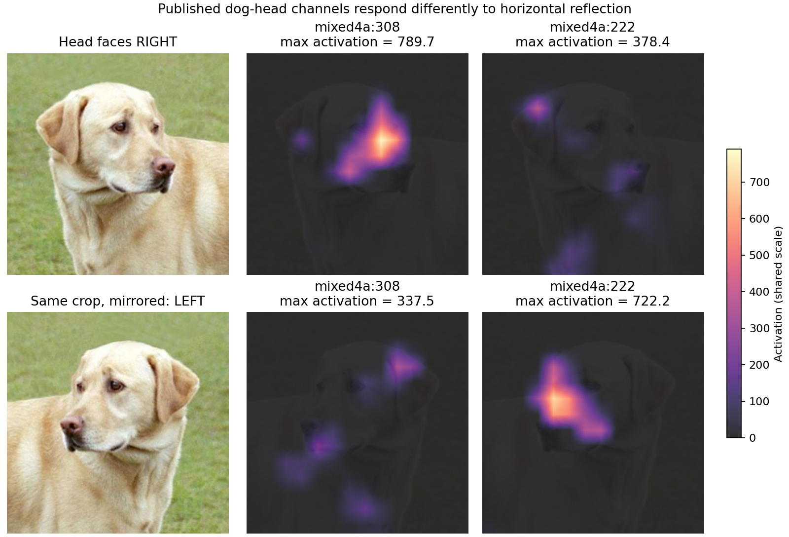
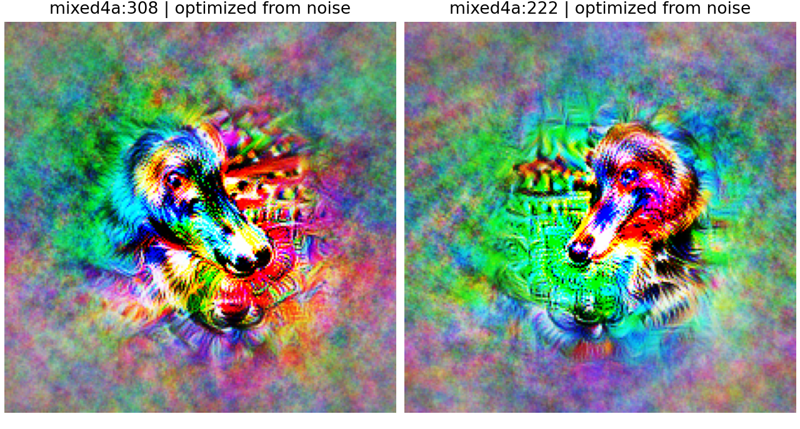

# 复现左右朝向的狗头特征

使用 Olah 等人在 [Zoom In: An Introduction to Circuits](https://distill.pub/2020/circuits/zoom-in/#claim-2-dog) 研究的 Lucid InceptionV1 权重，读取论文图中的 `mixed4a:308` 和 `mixed4a:222`。编号来自原论文仓库的 [DogCircuit.svg](https://github.com/distillpub/post--circuits-zoom-in/blob/master/public/images/DogCircuit.svg) 元素 ID，未根据本次图片搜索通道。

这里的左右均以**观看图片的人**为准。使用原图狗头的固定裁剪框 `(20, 0, 310, 290)`，缩放为 224×224，再对照水平镜像。模型输入为 RGB 像素减去 117，按 [Lucid 模型定义](https://github.com/tensorflow/lucid/blob/master/lucid/modelzoo/other_models/InceptionV1.py) 处理。



| 输入 | mixed4a:308 | mixed4a:222 | 后续 mixed4b:409 |
|---|---:|---:|---:|
| 狗头朝画面右侧 | 789.72 | 378.37 | 1051.29 |
| 同一裁剪水平翻转，朝左 | 337.55 | 722.21 | 1121.88 |

数值为该通道 14×14 激活图的最大值，非分类概率。308 和 222 的优势随朝向翻转而互换，后续 409 通道对两个方向均有较强响应。全图、扩大裁剪及灰度狗头也显示相同的优势反转；每个条件的最大值、均值及花卉对照均保存于 [measurements.json](results/measurements.json)。图上热图共享色阶，由原始 14×14 网格插值到照片大小；它展示粗略响应位置，不是精确分割。

## 运行

推荐 Python 3.11–3.13，使用单独虚拟环境：

```bash
python -m pip install -r requirements.txt
python experiment.py
python experiment.py --synthesize --steps 256
jupyter lab dog-direction.ipynb
```

首次下载约 51 MiB 的原研究 InceptionV1 模型，以及一张拉布拉多照片到 `cache/`。这是原研究对应的模型版本，与父目录 torchvision GoogLeNet 的具体权重和通道编号不同。全部推理固定网络参数，没有训练“左右分类器”。

`--synthesize` 从固定种子的随机 Fourier 参数开始，用梯度上升增强两通道中心 2×2 区域的 pre-ReLU 激活。低频优先参数化、sigmoid 像素约束和随机平移有助于产生可观察结构；优化 pre-ReLU 可避免初始 ReLU 输出为零时没有梯度。只更新图像参数。合成结果保存在 `results/feature-*.png`，它们不是输入的狗照片。



256 步优化后，308 通道生成朝画面右侧的长嘴狗头，222 生成朝左的长嘴狗头。这个形态判断来自对合成图的观察，与照片镜像实验的方向偏好一致。

## 适用范围与局限

本实验复现的是论文指定单元的方向偏好，以及一个后续单元对两个朝向的响应。自然照片实验只有一只狗，多个裁剪不是独立样本；水平翻转也会翻转背景，花卉对照同样有较弱的方向差异。它不是全犬种准确率测试，也没有通过消融或权重编辑验证论文完整的跨层兴奋、抑制连接。

## 来源与图片许可

- 研究：Olah et al., *Zoom In: An Introduction to Circuits*, Distill, 2020。
- 模型：[Lucid InceptionV1](https://storage.googleapis.com/modelzoo/vision/other_models/InceptionV1.pb)。模型 SHA-256 随测量结果保存。
- 狗照片：[YellowLabradorLooking new.jpg](https://commons.wikimedia.org/wiki/File:YellowLabradorLooking_new.jpg)，摄影 Elf；衍生修改 Djmirko / FT2，经 TensorFlow 示例镜像获取，采用 [CC BY-SA 3.0](https://creativecommons.org/licenses/by-sa/3.0/)。本项目的 `direction-comparison.png` 对照片进行了裁剪、缩放、镜像和热图叠加，也按 CC BY-SA 3.0 提供。
- 花卉对照沿用父项目 `original.jpg`，来源与许可见父目录 README。
