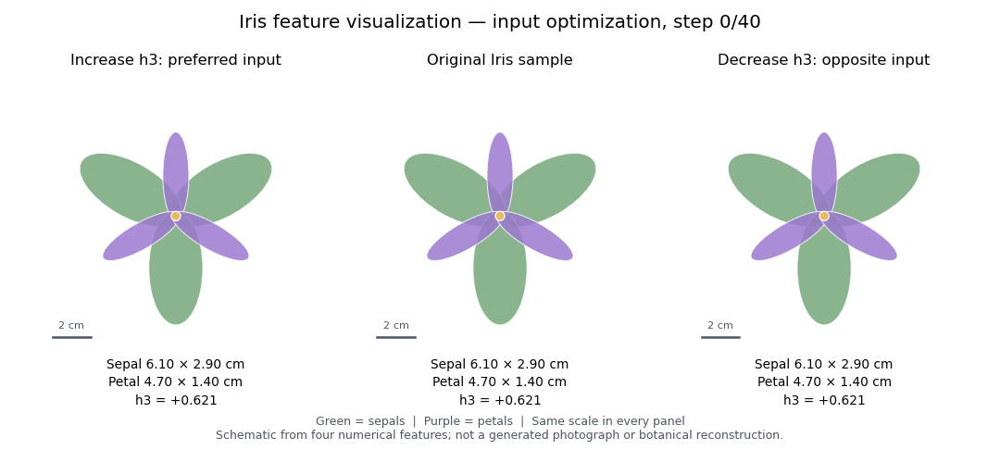
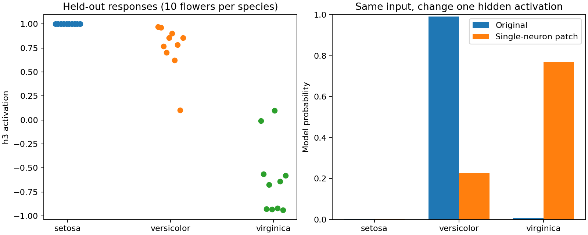

# Iris：51 个参数的机制可解释性实验

用 Iris 的 150 条样本训练一个 **4 → 6 → 3** 的小型全连接网络，复现“观察内部特征 → 优化输入 → 干预特征 → 检查输出”的方法。输入是四个尺寸，输出是三个鸢尾花类别。隐藏层为 tanh，输出为 softmax；参数总数为 `4×6 + 6 + 6×3 + 3 = 51`。

直接阅读并逐格执行 [iris-mechanistic.ipynb](iris-mechanistic.ipynb)。完整脚本是 [experiment.py](experiment.py)，全部权重、数据划分和实验结果位于 [results/model.json](results/model.json)。

## 运行

推荐 Python 3.11–3.13，在本目录执行：

```bash
python -m pip install -r requirements.txt
python experiment.py
jupyter lab iris-mechanistic.ipynb
```

使用 scikit-learn 自带的 Iris 数据，无需下载模型或使用 GPU。固定划分种子 42、模型初始化种子 7；120 条训练、30 条测试，标准化器只拟合训练集。一次固定配置训练得到 **29/30** 测试正确，未搜索随机种子。

## 1. 哪个隐藏神经元在区分类别？

先用训练集衡量各神经元对 Virginica 与 Versicolor 类别平均 logit 差异的贡献，选择贡献最大的 h3；再查看留出测试集的响应。使用 1 起始编号，h3 对应代码索引 2。

该神经元的实际计算近似为：

```text
h3 = tanh(0.088·z花萼长 + 0.666·z花萼宽
          − 2.033·z花瓣长 − 1.239·z花瓣宽 + 2.313)
```

`z` 是按训练集均值和标准差归一化后的尺寸。其他输入固定时，较长、较宽的花瓣降低 h3。测试集中，Setosa、Versicolor、Virginica 的 h3 平均激活分别约为 **1.000、0.753、−0.608**。它代表一种尺寸组合，不能简单命名为某个物种的专属神经元。

## 2. 类比 DeepDream：神经元偏好怎样的输入？

固定网络，对 h3 求四个输入的梯度，分别做 40 步上升和下降，并限制每个尺寸在训练集范围内。从真实测试样本 `[6.1, 2.9, 4.7, 1.4]` cm 开始：

- 增强 h3 时，花瓣长度从 4.7 cm 减到 1.1 cm，宽度从 1.4 cm 减到约 0.183 cm。
- 降低 h3 时，花瓣长度增到 6.9 cm，宽度增到 2.5 cm。

输入变化符合上面的权重公式。这里把图片版 DeepDream 的“改变像素”换成“改变四个尺寸”，观察的是数值特征偏好。



左侧增强 h3，中间保留原始样本，右侧减弱 h3。绿色为花萼，紫色为花瓣，三个面板使用相同厘米尺度。椭圆的长短轴按真实优化后的尺寸绘制；颜色、排列和花瓣数量是固定的示意布局，并非模型生成的照片或植物学重建。静态对比见 [最终花形图](results/flower-input-ascent.png)，执行 `python draw_flowers.py` 可重新生成两张图。

## 3. 因果干预：尺寸不变，只改变 h3

对同一个 Versicolor 测试样本，保持四个输入、模型权重和其他五个隐藏激活不变。将 h3 从 **0.621** 替换为 Virginica 训练样本的中位激活 **−0.774**：

| 输出类别 | 原始概率 | 仅替换 h3 后 |
|---|---:|---:|
| Setosa | 0.18% | 0.30% |
| Versicolor | 99.10% | 22.74% |
| Virginica | 0.72% | 76.95% |

这说明 h3 实际影响该样本的分类。在这个单隐藏层网络中，影响还可以精确计算：`Δlogits = Δh3 × W2[h3, :]`。程序逐项验证了这个等式。代表样本按距训练类别中心最近的测试样本选取，未按干预效果选择。



## 检查与实验边界

手写前向计算与 sklearn 输出一致；输入梯度通过有限差分检查；40 步目标变化保持单调；干预前后参数摘要一致。将 h3 统一替换为训练集平均激活时，测试正确数从 29/30 变成 28/30。

本实验展示的是固定小模型的一个可解释计算及其因果影响。它不是模型改进：干预后的分类对原样本反而是错误的。h3 与其他神经元存在冗余；单个尺寸在观测范围内也不保证合成尺寸组合对应真实花朵。此处没有图片、左右朝向或对全部随机初始化都成立的神经元编号。

数据来自 [scikit-learn Iris 数据集](https://scikit-learn.org/stable/modules/generated/sklearn.datasets.load_iris.html)。方法上承接父目录的 DeepDream 与狗头通道实验。
