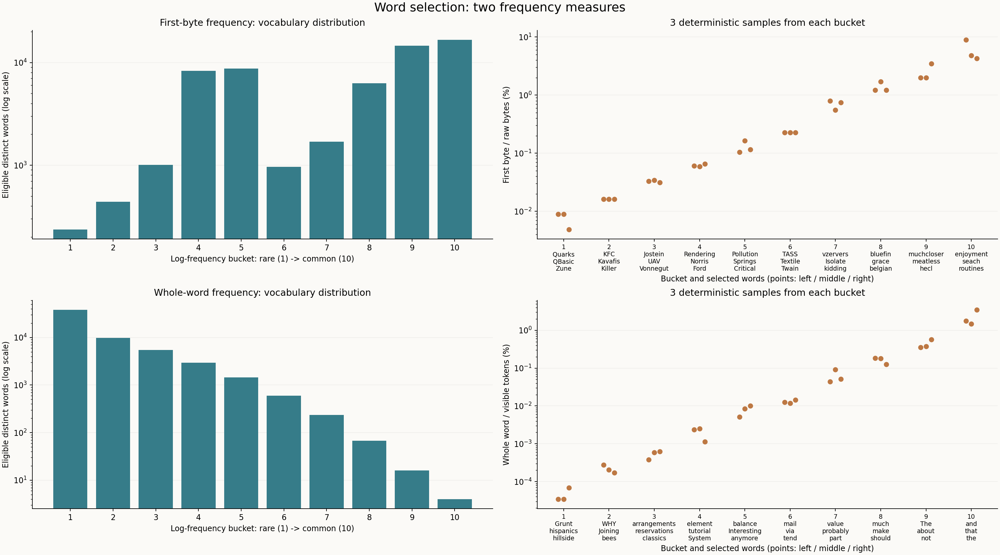
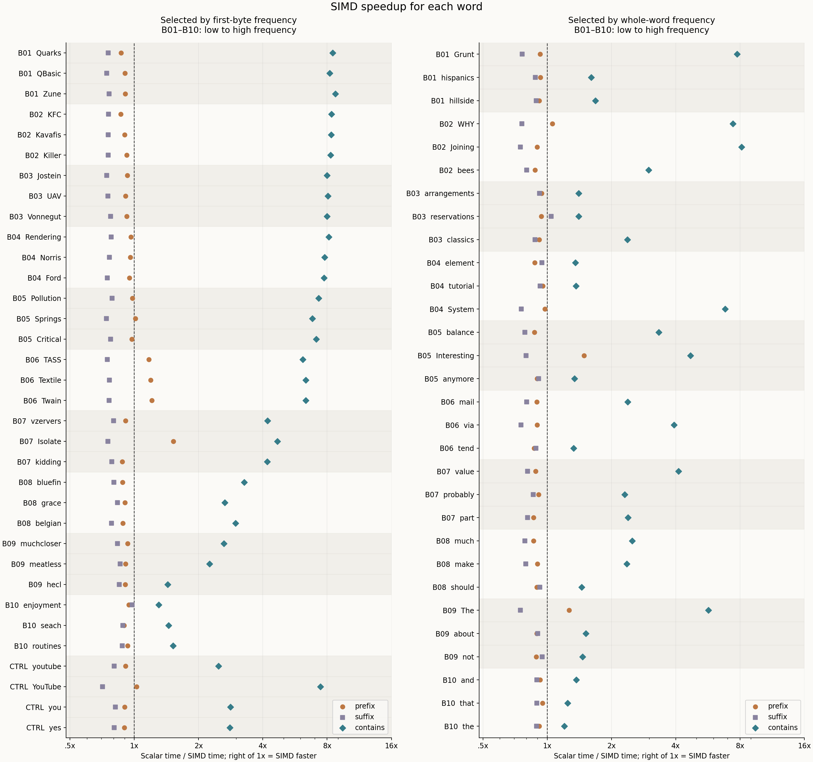
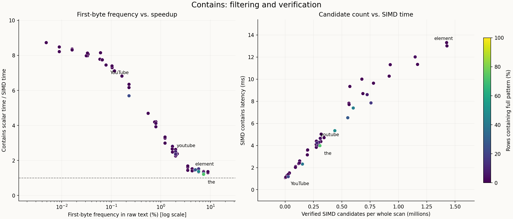
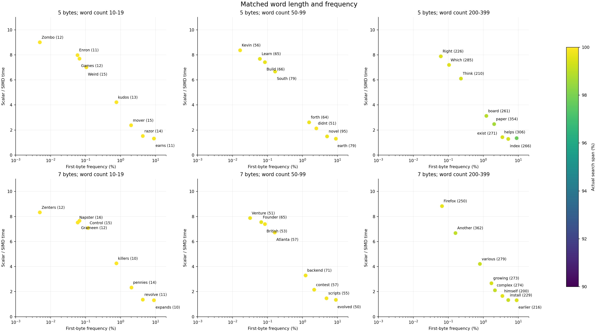
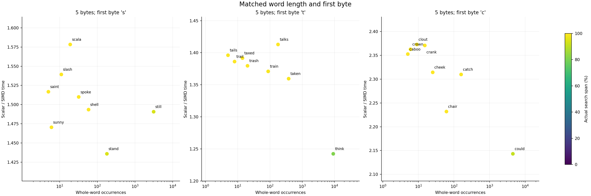

# 从 Hacker News 评论里找 YouTube：字符串匹配是怎样跑起来的？

Karpathy 的 HackerTube 项目给了这个实验一个具体问题：**评论里已经有大量视频推荐，怎样先找出可能包含 YouTube 链接的评论？**

把评论正文交给下面这样的条件，就能得到第一批候选行：

```sql
SELECT text FROM comments WHERE text LIKE '%youtube%';
```

其中最底层的问题是：一条评论的字节串里，有没有连续出现 `youtube`？筛出评论后，再解析 HTML、识别 URL、提取视频 ID，才进入视频推荐的后续处理。本教程聚焦这一步字符串筛选，用真实评论解释标量和 SIMD，并用同一批真实评论测量它们。

## 先跑起来

```sh
python3 -m pip install -r requirements.txt
python3 run.py --trace-only     # 用保留的一条真实评论演示匹配，无需完整样本
python3 run.py --plots-only     # 根据已提交的结果重画图
python3 run.py                  # 需要本地样本：统计词频并重跑全部对照
```

实测使用约 16 MiB 的真实正文：**51,204 行、16,776,695 字节**，来自 [OpenIndex 的 Hacker News 数据集](https://huggingface.co/datasets/open-index/hacker-news)，按完整行截取，未改写文字。原始样本仅保留在本地，不随仓库提交；仓库保留一条演示评论、来源、校验值和实测结果。重跑基准所需文件格式见 [数据说明](data/ATTRIBUTION.md)。

## 一条真实评论，两个不同的 y

样本第 6,946 行的开头是：

```html
This one is easy for me: <a href="http://www.youtube.com/watch?v=1u3ekzwnYxw">…
```

这里有两个值得看清的位置：

- `easy` 中的 `y` 在字节位置 **15**。它与 `youtube` 的首字节相同，但后面接的是空格，完整模式匹配失败。
- `youtube.com` 中的 `y` 在位置 **45**。后面六个字节正好是 `outube`，匹配成功。

演示使用这条完整评论，直接从样本中取出，行号和截取范围见 [trace.json](data/trace.json)。它还保留了 HTML 链接的显示文字；匹配到第一个 `youtube` 时，本查询就结束这一行。

### 标量怎样找？

标量维护一个起点 `j`。从起点开始逐个比较模式字节，遇到不等就换下一个起点：

```cpp
if (text.size() < needle.size()) return false;
for (size_t j = 0; j <= text.size() - needle.size(); ++j) {
    // 先比较 text[j] 与 'y'；相等才继续比较 'o'、'u'、't'……
    if (scalar_equal(text.substr(j, needle.size()), needle)) return true;
}
```

`scalar_equal` 就是手写的逐字节相等判断，完整实现如下：

```cpp
inline bool scalar_equal(std::string_view a, std::string_view b) {
    if (a.size() != b.size()) return false;
    for (size_t k = 0; k < b.size(); ++k) {
        if (a[k] != b[k]) return false;
    }
    return true;
}
```

它先判断长度，然后从左到右比较，**遇到第一个不同字节立即返回 false**。全部相等才返回 true；两个空串也相等。`string_view` 只保存指针和长度，`substr` 在这里产生另一个视图，不复制正文。

这个函数在三处复用：标量 prefix/suffix 比较唯一的固定位置；标量 contains 对每个起点调用它；SIMD contains 筛出首字节相同的候选后，也用它验证剩余字节。因此 SIMD contains 的加速来自批量排除起点，候选的剩余字符仍由同一段手写标量代码验证。

对于这条评论，很多起点只比较一个字节就失败。在位置 15，`y` 相同、下一字节空格与 `o` 不同，于是继续试位置 16。直到位置 45，七个字节全部相同。

### SIMD 怎样找？

SIMD 一次装载 16 个文本字节，把它们**分别当作 16 个起点的首字节**。另一个向量的 16 个字节都填成 `y`。逐 lane 相等比较之后，只有值为 `y` 的那些位置留下来。

先把完整过程写成伪代码。`text` 是一条评论，`needle` 是要找的 `"youtube"`；`j` 是当前块在评论中的起点，`lane` 是块内的编号 0–15。下面的切片 `[a:b]` 包含位置 a，不包含位置 b。

```text
function contains_simd(text, needle):
    n = text 的字节数
    m = needle 的字节数
    if m == 0: return true
    if n < m:  return false

    starts = n - m + 1                    # 有多少个起点能放下完整模式
    target = broadcast16(needle[0])        # ['y', 'y', ...]，共 16 个 y
    j = 0

    while j + 16 <= starts:                # 本块有 16 个合法起点
        chunk = load16(text, j)           # 读取 text[j : j+16]
        hit = compare_equal16(chunk, target)
        # 上面是一次向量比较，同时得到 16 个判断：
        # hit[i] = FF，当 text[j+i] == 'y'；否则 hit[i] = 00

        if any_lane_is_FF(hit):
            for lane = 0 to 15:           # 进入候选处理阶段
                if hit[lane] == 00:
                    continue
                pos = j + lane           # 还原候选在整条评论中的位置
                # 首字节已确认，只需验证剩下的 "outube"
                if scalar_equal(text[pos+1 : pos+m], needle[1:m]):
                    return true           # 完整匹配成功，结束这一行
                # 验证失败：继续检查本块剩余的候选

        j = j + 16                        # 本块没有完整匹配，再读下一块

    while j < starts:                     # 剩余不足 16 个起点，逐个处理
        if scalar_equal(text[j : j+m], needle):
            return true
        j = j + 1

    return false                          # 所有合法起点都试过了
```

三个向量操作分别做什么，可以直接对上实现：

| 伪代码 | 含义 | 本项目的 NEON 操作 |
|---|---|---|
| `load16(text, j)` | 从位置 j 装载连续 16 个文本字节 | `vld1q_u8` |
| `broadcast16('y')` | 把一个 y 复制成 16 个 y | `vdupq_n_u8` |
| `compare_equal16(chunk, target)` | 同编号的 lane 分别判等，一次产生 16 个 00 / FF 结果 | `vceqq_u8` |

这里有两个不同的推进动作：**扫描块用 `j += 16`；验证候选时才按 lane 找到具体位置。** 伪代码为了易读，依次检查 16 个 `hit[lane]`；实际代码会先提取整数 mask，再只枚举其中置位的候选，下面会展开这一段。

同一条真实评论的前三个块如下。块中的空格是原文的一部分；位置从 0 开始：

| 块起点 j | 装载的 16 个字节 | 哪个 lane 等于 y？ | 这个块的处理结果 |
|---:|---|---|---|
| 0 | `This one is easy` | lane 15 | 候选位置 0 + 15 = 15，验证失败 |
| 16 | ` for me: <a href` | 没有 | 整块跳过 |
| 32 | `="http://www.you` | lane 13 | 候选位置 32 + 13 = 45，验证成功 |

**lane 就是这个 16 字节块里的编号。** 例如第三块的 lane 13 对应文本的第 45 字节。比较结果没有直接声称“这里是 youtube”，只声称“这里是 y，值得进一步检查”。

### 候选验证：失败继续，成功返回

实现将 16 个 lane 的判断压成一个整数 mask：第 i 位为 1，表示 lane i 是候选。随后反复取出最低的一位：

```cpp
while (mask != 0) {
    unsigned lane = __builtin_ctz(mask); // 找最低的置位：不是再次扫描文本
    size_t pos = j + lane;              // 从块内编号还原文本位置
    if (scalar_equal(text.substr(pos + 1, needle.size() - 1),
                     needle.substr(1))) return true;
    mask &= mask - 1;                   // 验证失败：只移除刚才这个候选
}
j += 16;                                // 本块候选耗尽：再读下一块
```

把这段控制流代入真实评论：

1. **第一块的 mask 是 `0x8000`。** 只有 bit 15 是 1，`ctz(mask)` 得到 15。首字节 `y` 已经确认，所以从位置 16 开始验证后面六个字节：`" for m"` 对 `"outube"`，第一个字节就失败。
2. **清掉 bit 15，mask 变成 0。** 这个块没有别的候选，`j` 从 0 增到 16。若一个块还有其他置位，程序会先验证那些候选，保持 `j` 不变。
3. **第二块的 mask 为 0。** 没有任何 `y`，直接让 `j` 从 16 增到 32。
4. **第三块的 mask 是 `0x2000`。** `ctz` 得到 13，候选位置是 `32 + 13 = 45`。从位置 46 读取的六个字节为 `outube`，验证成功。
5. **返回这一行匹配成功。** 外层累计命中行数，然后处理下一条评论。后面即使还有第二个 YouTube 链接，也无需继续找。

注意第三块只装载到位置 47，`youtube` 的后半部分在下一块范围里。候选验证直接访问原文本，所以能从位置 46 一直比较到 51。扫描块是筛选起点的单位，不是禁止模式跨越的边界。kernel 只筛选剩余长度足以容纳完整模式的合法起点，尾部不足 16 个起点时改用标量。

对应代码是 [match.h](match.h) 的 `first_mask` 与 `simd_contains`。可执行过程保存在 [trace.txt](results/trace.txt)，其中打印了每一次 mask 清除和返回动作。

## memchr：先找首字节，再验证剩余字符

`memchr(p, byte, count)` 在从 `p` 开始的 `count` 个字节里，返回**第一次出现这个单字节的位置**；找不到返回空指针。它知道要找 `y`，不知道整个模式是 `youtube`。本项目把它与 `scalar_equal` 组合成 contains，代码位于 [match.h](match.h)：

```cpp
inline bool libc_contains(View s, View n) {
    if (n.empty()) return true;
    if (s.size() < n.size()) return false;
    size_t j = 0;
    const size_t starts = s.size() - n.size() + 1;
    while (j < starts) {
        const auto* p = static_cast<const char*>(
            std::memchr(s.data() + j,
                        static_cast<unsigned char>(n[0]), starts - j));
        if (!p) return false;
        j = static_cast<size_t>(p - s.data());
        if (scalar_equal(s.substr(j + 1, n.size() - 1), n.substr(1)))
            return true;
        ++j; // 验证失败，从这个候选之后再次调用 memchr
    }
    return false;
}
```

在那条真实评论中，第一次 `memchr` 返回位置 15（`easy` 中的 y）；`scalar_equal` 发现空格不等于 o，下一次从位置 16 开始找。第二次 `memchr` 返回位置 45，再验证 `outube`，这一行成功。查找范围的长度是 `starts - j`，只包含能放下完整模式的合法起点。

### 本机的 memchr 确实使用 NEON

**本机实测的 memchr 对照是“系统 NEON 搜索 + 标量验证”。** 在 macOS 26.6.1（25G76）、arm64 上，用 LLDB 从基准程序的 `libc_c` 调用点单步进入 `memchr` 跳板，最终进入 `libsystem_platform.dylib` 的 `_platform_memchr`，并执行到向量加载和减法之后。

它每轮处理 **16 字节**。下面摘出实际反汇编中的关键指令；完整调用链和指令见 [memchr-inspection.txt](results/memchr-inspection.txt)。

```asm
dup.16b   v1, w1              // 把目标字节复制到 16 个 lane
ldr       q0, [x0]           // 装载 16 字节
sub.16b   v0, v0, v1         // 相等的 lane 相减后为 0
uminv.16b b2, v0             // 取无符号最小值；为 0 表示有匹配
fmov      w3, s2
cbz       w3, ...            // 有匹配：进入最早位置的定位逻辑
```

无匹配时，循环前进 16 字节；有匹配时，用 `cmhi.16b`、`orr.16b` 和另一条 `uminv.16b` 定位最早匹配。首块会屏蔽起点之前的字节，返回前检查匹配是否在长度范围内。这条路径使用向量减法与归约来判等，和本项目的 `cmeq + mask` 路径不同。

| contains 路径 | 找首字符 | 候选验证失败后 |
|---|---|---|
| scalar | 逐起点比较 | 换下一个起点 |
| 手写 SIMD | NEON 过滤一块，保留所有候选的 mask | 清掉当前位，继续验证同块候选 |
| memchr 对照 | 系统 NEON 搜索，返回最早的一个候选 | 从候选后一字节重新调用 memchr |

三条路径都用 `scalar_equal` 验证完整模式；后两条只需验证首字符之后的部分。因此，手写 SIMD 与 memchr 的性能差异包含**候选定位、mask 提取、重复调用和对齐处理**的成本，两者的搜索阶段都使用 SIMD。

复现检查：先运行主实验，再执行 `python3 inspect_memchr.py`。脚本会跟踪当前程序实际跳转到的实现，并保存反汇编；调试期间的耗时不写入性能结果。这里的结论对应本机当前加载的系统实现。

## prefix、suffix 与 contains 的区别

三种形状问的是不同问题，但每个实验始终用相同文本、相同模式：

| 形状 | 示例条件 | 起点怎样决定？ | SIMD 的 lane 在比较什么？ |
|---|---|---|---|
| prefix | `LIKE 'youtube%'` | 唯一位置 0 | 同一个模式里的不同字节 |
| suffix | `LIKE '%youtube'` | 唯一位置 `行长 - 7` | 同一个模式里的不同字节 |
| contains | `LIKE '%youtube%'` | 从全部合法起点中寻找 | 16 个起点各自的首字节 |

prefix 和 suffix 都无需搜索位置。对于足够长的行，prefix 装载开头 16 字节，将其中前七个 lane 与 `youtube` 比较；suffix 装载最后 16 字节，把 `youtube` 放到右侧七个 lane。mask 指定哪些 lane 必须相等，其余 lane 忽略。

模式与 mask 在扫描行之前准备一次。短行通过局部填充副本安全比较，长模式按块比较。这样固定位置的“宽比较”和 contains 的“多起点过滤”在代码里是两个清楚的步骤。

对于上面那条评论，prefix 与 suffix 都失败、contains 成功，正符合三个条件各自的含义。完整样本里 `youtube` 的 prefix/suffix 都是零命中，也会正常计时和校验；分桶抽样中的 `The` 提供了实际行首命中，机制对照 `you` 也有实际行末命中。

## 从向量操作到机器指令

教程里出现的不只是 `cmpeq`。下面按数据流列出主要操作，右列来自本机 Apple clang 17 的 ARM64 编译结果：

| 代码操作 | 用途 | 本次汇编中看到的实现 |
|---|---|---|
| `vld1q_u8` | 从文本读 16 字节 | `ldr q` |
| `vdupq_n_u8` | 把 y 复制到 16 个 lane | `dup.16b` |
| `vceqq_u8` | 16 组字节分别判等，得到 00 / FF | `cmeq.16b` |
| `vmaxvq_u8` | 归约为一个值，判断块内有没有候选 | `umaxv.16b`，再用 `fmov` / `cbz` 判断 |
| `vst1q_u8` 与逐 lane 提取循环 | 将有候选的块整理成 16 位 mask | 此处存储被优化掉，生成 `umov.b`、`tst`、`cset`、移位 `orr` 等多条指令 |
| `__builtin_ctz(mask)` | 找 mask 中最低置位的位置 | `rbit` + `clz` |
| `mask & (mask - 1)` | 删除刚刚验证过的候选 | `sub` + `and` |
| `vandq_u8` + `veorq_u8` | prefix/suffix 只检查指定 lane | 编译器把这组表达式合并成 `bic.16b`，随后归约 |

`vorrq_u8` 它把两个向量逐位 OR，可以把四个块的比较结果合并，先判断这四块是否都没有候选；若有候选，还得回到各块结果定位。这里的实现每次处理一块。AVX2 的 `__m256i` 宽 32 字节，本机 NEON 寄存器宽 16 字节；广播首字节、逐 lane 判等、再验证候选的流程相同。

因此，“16 个字节的相等判断是一条指令”描述的是 `cmeq` 这一步；装载、候选检测、mask 提取和剩余字节验证各有成本。这个教学实现特意保留容易读懂的 lane 提取循环，候选密集时它会执行很多指令。

```sh
make assembly
# 查看 build/instruction_probe.s 中四个独立函数
```

[instruction_probe.cpp](instruction_probe.cpp) 把过滤、固定位置比较、取候选和清候选做成独立编译入口。它帮助核对 intrinsic 与本次生成指令的对应关系；完整程序内联后的寄存器分配和调度可能不同。x86 SSE2 分支使用 `_mm_movemask_epi8` 提取位掩码，本次实际计时的是 ARM NEON 分支。

## 从两个分布各取十个桶，再抽测试词

分别从原始字节和可见评论中统计两个分布，保留大小写，候选词限定为 3–16 个英文字母：

- **首字符频率（首字节频率）**：测试词的第一个字符在全部原始正文中出现的次数 ÷ 原始正文总字节数。例如 `youtube` 使用所有位置的 `y` 的频率，`the` 使用所有位置的 `t` 的频率。候选词均为 ASCII，因此这里一个字符对应一个字节。
- **全文词频概率**：某词在全部评论中的完整词次数 ÷ 全部词 token 数。

去掉 HTML 标签、解码实体后，以连续英文字母分词。kernel 仍然匹配原始正文的字节子串，因此程序另外统计精确的 prefix/suffix/contains 命中行数、原始首字节频率和首次匹配位置，帮助把文本统计对应到实际工作。

每个分布按最小正频率到最大频率划分 **10 个等对数宽度的桶**，每桶抽 3 个词。同一首字符的词进入同一个首字符桶；完整词频则各自计数。对数分桶能同时覆盖稀有词和高频词。

[select_keys.py](select_keys.py) 用固定种子、分布名、桶号和词生成哈希排序，取前三个。加上 `youtube / YouTube / you / yes` 四个对照，共 64 个词；对照词不计入分桶汇总。

**候选词多以常见字符开头，但完整词本身大多只出现少数几次，因此两种频率需要分别取样。**



左列是各桶的候选词数，右列是抽中词的频率。桶号下方从上到下的三个词，对应点从左到右；纵轴均为对数刻度。抽样记录见 [bucket-selection.csv](results/bucket-selection.csv)。

全量统计分别在 [word-frequency.csv](results/word-frequency.csv)、[byte-frequency.csv](results/byte-frequency.csv)；每个测试词的字节频率与匹配统计见 [key-statistics.csv](results/key-statistics.csv)。

## 三种匹配的逐词性能

**这批词的 contains 都从 SIMD 获益；prefix 和 suffix 多数更慢。**

**左图的结论：首字符越常见，contains 的 SIMD 优势总体越小。** 从 B01 到 B10，加速比中位数由 8.48× 降到 1.45×。首字符出现得越多，过滤后留下的候选通常也越多，需要逐个验证。

**右图的结论：完整词频越高，SIMD 优势没有单调变化。** 高频词可能更早被找到，但标量和 SIMD 都会少做工作，因此加速比不一定提高。

这两栏展示总体关系。后面的分组实验进一步固定词长、限制完整词频：六组中，首字符稀疏的一端都比密集的一端获得更大的 SIMD 加速。

两栏的区别是**选词依据**，都展示同样三种匹配的加速比：

| 栏 | 按什么频率选词 | 例子 |
|---|---|---|
| 左栏 | 测试词首字符在全部原始正文中的占比 | `Quarks` 按 `Q` 的出现次数入桶 |
| 右栏 | 完整词在可见文本中的次数 ÷ 全部词数 | `Grunt` 按完整词 `Grunt` 的出现次数入桶 |

`B01`–`B10` 是**各栏独立划分的十个等对数宽度桶**，编号越大，所依据的频率越高；每桶选三个词。它们按频率区间划分，各桶词数不等，两栏的同号桶也不表示相同概率。例如左栏 B01 对应首字符出现约 818–1733 次，右栏 B01 对应完整词出现 1–3 次。完整边界见 [bucket-selection.csv](results/bucket-selection.csv)。`CTRL` 是四个额外对照词，不属于这些桶。

每行一个词，三个点分别是 prefix、suffix、contains。横轴为**标量耗时 / SIMD 耗时**，使用对数刻度；1× 左侧更慢、右侧更快，2× 表示耗时减半。两栏的横轴相同，可以直接比较加速比。



<!-- MEASURED_RESULTS_START -->
### youtube 的耗时与工作量

| 形状 | 标量 ms | SIMD ms | 加速比 | 标量尝试起点数 | 标量字节比较数 |
|---|---:|---:|---:|---:|---:|
| prefix | 0.0876 | 0.0961 | 0.91× | 50,784 | 51,189 |
| suffix | 0.0761 | 0.0946 | 0.80× | 50,784 | 51,706 |
| contains | 10.8738 | 4.3915 | 2.48× | 16,423,912 | 16,820,472 |

标量 prefix 平均每行比较 **1.00 个字节**，suffix 是 **1.01 个字节**。它们已经很快结束，SIMD 的固定装载与归约成本很难摊薄。contains 的标量则尝试 **16,423,912 个起点**；SIMD 用 **1,002,826 个完整块**过滤，再验证 **275,589 个候选**，另有 **379,883 个尾部起点**。contains 省掉的是大量逐起点工作，这正是三种形状加速幅度不同的直接原因。

### 典型词的候选数与耗时

搜索范围累计每行开头到首次匹配末尾的字节数；未命中的行计入全文，再除以正文总字节数。它描述提前退出，不是实际内存读取量。

| key | 首字节占比 | 完整模式命中行占比 | 逻辑搜索范围 | SIMD 候选数 | SIMD ms | 标量 / SIMD |
|---|---:|---:|---:|---:|---:|---:|
| youtube | 1.715% | 0.31% | 99.72% | 275,589 | 4.391 | 2.48× |
| YouTube | 0.078% | 0.45% | 99.45% | 12,615 | 1.238 | 7.45× |
| you | 1.715% | 39.54% | 58.12% | 152,516 | 2.317 | 2.82× |
| yes | 1.715% | 1.53% | 98.37% | 274,899 | 3.833 | 2.80× |
| the | 7.278% | 72.45% | 26.08% | 306,870 | 3.986 | 1.20× |
| element | 8.904% | 0.27% | 99.55% | 1,428,262 | 13.011 | 1.36× |

`you` 和 `yes` 共享首字节。`you` 更常提前命中，SIMD 耗时更短（2.317 / 3.833 ms），但加速比接近（2.82× / 2.80×）：标量也从提前退出中受益。

完整选词、计数区间和词池大小见 [bucket-selection.csv](results/bucket-selection.csv)；图中已标出每桶三个词。

### 分桶结果

首字节频率第 1 桶与第 10 桶的 contains 加速比中位数为 8.48× / 1.45×。这两端分别抽自首字节稀疏和密集的词池，用来观察过滤候选的难易程度。全文词频第 1 桶与第 10 桶对应 1.68× / 1.25×，观察的是完整词出现频率这一不同维度。每桶只有三个词，词长、命中位置和验证长度也会变化；应结合逐词图与实际工作量理解曲线。分桶汇总见 [bucket-performance.csv](results/bucket-performance.csv)。

### 自动向量化与 libc 对照

| key | 手写标量 ms | 手写 SIMD ms | 系统 NEON memchr + 验证 ms | 默认 -O3 标量 / SIMD ms |
|---|---:|---:|---:|---:|
| youtube | 10.874 | 4.391 | 4.475 | 11.400 / 4.521 |
| YouTube | 9.220 | 1.238 | 0.884 | 9.376 / 1.229 |
| you | 6.527 | 2.317 | 2.454 | 6.476 / 2.339 |
| the | 4.796 | 3.986 | 4.345 | 4.799 / 3.720 |

默认优化也可能改变 lane 提取与辅助代码，表中测的是完整编译产物。全部 64 个 key 的逐项数据与三轮范围保存在 `summary.csv`，分桶统计只汇总每桶抽中的三个词。

<!-- MEASURED_RESULTS_END -->

## 为什么 contains 加速明显，prefix/suffix 常常没有？

**contains 用 SIMD 批量省掉“试起点”这层循环，prefix/suffix 原本就只有一个起点。** 这是两者收益的主要结构差别。

对一行几百字节的文本，若模式不存在，标量 contains 要试几百个起点。每个起点至少比较首字节，只有首字节相同才继续。SIMD 每次筛选 16 个起点，一个没有候选的块可以整体跳过；稀疏首字节下，大量标量循环控制和首字节比较被批量过滤替代。

prefix 已知起点是 0，suffix 已知起点是 `行长 - 模式长`。标量在这个位置发现首字节不等就结束，可能总共只读一个字节。SIMD 固定要加载向量、比较并归约，省下的工作很少。若很多行需要比较模式的多个字节，宽比较才有更多收益空间。上面的工作量表给出这批数据实际比较的次数，而不是用“SIMD 一次 16 字节”直接推断 16 倍加速。

对 contains 可以用下面的成本拆解理解测量：

```text
标量成本 ≈ 每个实际起点的循环与首字节比较 + 继续比较的字节
SIMD成本 ≈ 每个块的装载与过滤 + 活跃块的mask提取 + 候选验证 + 标量尾部
```

这些项由模式的长度、首字节密度、完整命中位置共同决定。对于 suffix，相关的是后缀比较位置的字符和匹配概率；全文首字符频率并不描述这个固定位置，所以仍需看每个词实际的 suffix 命中数与比较次数。

## 首字符过滤与候选验证成本

**首字符稀疏时，contains 通常获得更大的 SIMD 加速；留下的候选越多，验证成本也越高。** 下面是主实验 64 个词的总体分布，控制词频和词长后的比较见下一节。



左图横轴是首字符占比，纵轴是标量耗时 / SIMD 耗时。右图横轴是完整 SIMD 块内的候选验证总数（百万次），纵轴是 SIMD 耗时（ms）。两图颜色均表示完整模式命中的评论比例。

`YouTube` 和 `youtube` 的扫描量相近，但候选数分别为 1.26 万和 27.6 万，SIMD 耗时分别为 1.24 和 4.39 ms，加速比分别为 7.45× 和 2.48×：较少的候选留下了更大的过滤收益。

同以 `t` 开头的 `the` 和 `tutorial` 在左图横坐标相同。`the` 经常提前命中，SIMD 耗时更短（3.99 / 11.34 ms），但标量也少做了工作，加速比分别为 1.20× / 1.37×。因此要分别观察绝对耗时和相对收益。候选之外的块扫描、mask 提取和尾部处理也计入总耗时。

## 首字符频率与完整词频的作用

**首字符频率影响候选过滤，完整匹配影响提前退出。** 比较首字符频率时，应尽量固定词长和完整词频；比较完整词频时，则固定词长和首字符。

完整词出现次数还需要结合实际命中行比例和命中位置来看：同一个词集中在少数评论中，与分散在许多评论中，会产生不同的扫描量。下面用分组实验检查这些关系。

<!-- GROUPED_START -->
## 控制词频和词长后的分组比较

**固定词长、限制完整词频后，首字符稀疏的组内端点仍获得更大的 SIMD 收益。**

补充实验选 72 个真实词，分九组、每组八词：六组固定词长（5 或 7 字节）和词频范围（10–19、50–99、200–399 次）；三组固定五字节长度和首字符（`s`、`t`、`c`）。选词只依据词表与字节计数。

每词测量七条路径、独立运行三轮，第二轮反转词序。下面展示 contains 的中位数结果；逐轮计时、命中率和工作量见 [grouped-summary.csv](results/grouped-summary.csv) 与 `results/grouped-{1,2,3}.csv`。

### 固定词频范围与词长

**六组都显示：首字符稀疏的一端约加速 8–9 倍，密集的一端约 1.3 倍。**



每格一组，括号内为完整词次数。横轴是首字符频率，纵轴是加速比；颜色表示搜索范围占正文的比例。六格坐标尺度相同。

| 组 | 完整词次数范围 | 命中行比例范围 | 实际搜索范围 | 最稀疏首字符的词 / 加速比 | 最密集首字符的词 / 加速比 |
|---|---:|---:|---:|---|---|
| 5 字节 / 10-19 次 | 11–15 | 0.02–0.05% | 99.92–99.99% | `Zombo` / 9.01× | `earns` / 1.33× |
| 5 字节 / 50-99 次 | 51–95 | 0.10–0.23% | 99.66–99.95% | `Kevin` / 8.37× | `earth` / 1.31× |
| 5 字节 / 200-399 次 | 210–354 | 0.46–1.68% | 97.76–99.54% | `Right` / 7.89× | `exist` / 1.36× |
| 7 字节 / 10-19 次 | 10–16 | 0.01–0.06% | 99.92–99.99% | `Zenters` / 8.34× | `expands` / 1.32× |
| 7 字节 / 50-99 次 | 50–71 | 0.08–0.27% | 99.63–99.91% | `Venture` / 7.88× | `evolved` / 1.35× |
| 7 字节 / 200-399 次 | 200–362 | 0.37–0.80% | 99.06–99.61% | `Firefox` / 8.84× | `earlier` / 1.32× |

六组的搜索范围都接近整份正文，组内差异主要表现为首字符过滤后留下多少候选。

### 固定首字符与词长

**这三组中，完整词频越高并未带来持续上升的加速比。**



每格固定一个首字符，横轴为完整词次数，纵轴为加速比，颜色表示搜索范围。三格纵轴范围不同，比较数值时请读刻度。下表列出各组词频最低和最高的词。

| 组 | 词（次数） | 命中行比例 | 搜索范围 | 标量 ms | SIMD ms | 加速比 |
|---|---|---:|---:|---:|---:|---:|
| 首字符 `s`，5 字节 | `saint` (5) | 0.01% | 99.99% | 13.590 | 8.959 | 1.52× |
| 首字符 `s`，5 字节 | `still` (3091) | 5.44% | 93.96% | 14.153 | 9.494 | 1.49× |
| 首字符 `t`，5 字节 | `tails` (5) | 0.69% | 99.26% | 16.052 | 11.497 | 1.40× |
| 首字符 `t`，5 字节 | `think` (9117) | 15.95% | 81.22% | 14.300 | 11.508 | 1.24× |
| 首字符 `c`，5 字节 | `caboo` (5) | 0.01% | 99.99% | 11.905 | 5.060 | 2.35× |
| 首字符 `c`，5 字节 | `could` (4520) | 7.86% | 91.06% | 10.864 | 5.068 | 2.14× |

`think` 比 `tails` 少扫描约 18 个百分点的正文，标量耗时下降，SIMD 耗时接近，因此加速比从 1.40× 降到 1.24×。扫描量下降与相对收益增加是两件事。

### 适用范围与局限

分组限制了词长和词频，后续字符与命中位置仍有差异。完整词按可见文本分词统计，contains 则匹配原始字节子串；表中用实际命中率和搜索范围补足这一区别。

<!-- GROUPED_END -->

## 运行方法与测量口径

运行 `python3 grouped.py` 复现补充分组实验（先运行 `python3 run.py` 准备主实验）；`python3 grouped.py --plots-only` 根据已保存的分组结果重绘并更新本节。

macOS 默认显式编译 arm64，避免 x86 Python 的子进程默认目标改变实现路径。Intel Mac 可用 `python3 run.py --arch x86_64`；切换目标时脚本会重新编译。

`run.py` 校验样本 SHA-256，统计分布，编译两个版本，再依次测量。默认各做三次独立启动，交替两个版本的执行顺序；每个 kernel 内部用约 20 ms 的批次重复五次，取批次耗时中位数。文中汇总再取三次启动的中位数。

- `demo`：`-O3 -fno-vectorize -fno-slp-vectorize`，禁用编译器自动向量化，保留显式 intrinsics。
- `demo-auto`：默认 `-O3`，观察自动向量化后的实际结果。两者测量相同正文和同一组 key。
- 语料解压、读取、模式准备、正确性验证、候选计数与标量字节比较计数均在计时区之外。`volatile` sink 接收查询结果。
- 命中数先对照 C++ 标准库，再由 Python 的字节串操作独立核对，包括零命中情况。
- `logical_GBps` 是全体正文长度除以耗时；`Mrows` 是每秒处理的百万行数。read-all 参照确实读取整份正文，但它也是一个具体循环，并非硬件带宽上限。prefix/suffix 通常不读完整行，contains 也可能提前退出。

原始每轮结果与汇总保存在 [results](results/summary.csv)。全部图来自这些 CSV，重新运行脚本就会更新。`--plots-only` 只重新绘图，`--trace-only` 只演示真实评论。性能输入均来自上述真实样本；重跑计时需另行准备本地样本文件。

```sh
make test     # 92,580 组独立 oracle 检查，含保护页与跨块位置
make ubsan    # 同一批测试，启用 UndefinedBehaviorSanitizer
```

正确性测试单独构造空串、短串、随机二进制串和边界情况，以覆盖真实样本不一定出现的输入；这些构造数据不进入性能图。ASan 在本执行环境中连最小程序也停滞于启动阶段，因此测试记录以实际通过的普通构建、UBSan 和保护页为准，`make sanitize` 保留为其他环境的检查入口。

## 适用范围与局限

本实现处理字节串上的前缀、后缀和包含。完整 SQL LIKE 的转义、下划线、多段百分号、NULL，以及 ILIKE 的 Unicode 大小写语义属于更外层的规则。样本是已有正文导出的连续片段，没有显式排序或随机抽样；本次只在 ARM NEON 主机上计时，没有固定核心、采集硬件性能计数器或测量数据库端到端的解压成本。
